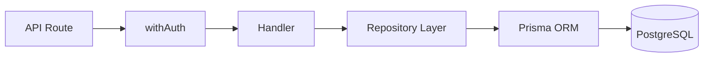

# Backend Architecture

## Authentication

Two auth mechanisms unified via `withAuth()` in `src/lib/auth-middleware.ts`:

| Method | Detection | Token Source |
|--------|-----------|-------------|
| **Web** (Supabase) | No `Authorization` header | `auth()` cookie session |
| **Mobile** (JWT) | `Bearer <token>` header | `getServerToken()` → `MOBILE_AUTH_SECRET` |

### Auth Wrappers

| Wrapper | Required Roles | Use |
|---------|---------------|-----|
| `withAuth(handler)` | Any authenticated user | General endpoints |
| `withAdmin(handler)` | ADMIN, SUPER_ADMIN, LEADER | Admin endpoints |
| `withSuperAdmin(handler)` | SUPER_ADMIN | Platform-level operations |
| `withTeacher(handler)` | TEACHER, ADMIN, SUPER_ADMIN, LEADER | Content management |
| `withContentManager(handler)` | Same as Teacher | Content CRUD |

## Role Hierarchy

```
SUPER_ADMIN → Full platform access
  └─ ADMIN → University-scoped management
       └─ LEADER → Student leader (moderation)
            └─ TEACHER → Content creation
                 └─ STUDENT → General access
```

## Data Access Pattern



Key layers:
- **`src/lib/repositories/`** — Encapsulated Prisma queries with `withRetry`
- **`src/lib/admin-scope.ts`** — University-scoped authorization guards
- **`src/lib/validation/`** — Zod schemas for input validation
- **`src/lib/api-error.ts`** — Standardized error responses

## Multi-Tenant Architecture

Data is scoped by `universityId`. Most queries filter through:
- `assertLecture(scope, id)` — validates lecture belongs to admin's university
- `assertSemester(scope, id)` — validates semester belongs to admin's university
- Entity chain: `University → AcademicYear → Semester → Module → Subject → Lecture`

## Key Libraries

- **ORM:** Prisma 5.22.0
- **Auth:** Supabase Auth (web) + JWT (mobile)
- **Validation:** Zod
- **Caching:** ioredis + Next.js unstable_cache
- **AI:** Google Gemini API

## Migrations

All migrations in `prisma/migrations/`. Apply with:
```bash
npx prisma migrate deploy
```
