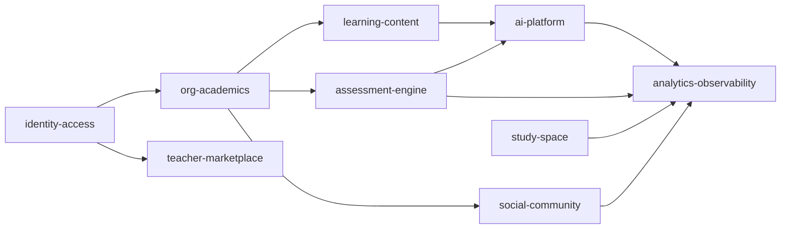

# MedQ V2 Domain Blueprint

## Bounded Contexts

- `identity-access`: authentication, identity providers, role assignments, policy evaluation.
- `org-academics`: tenant hierarchy (`University -> Faculty -> Program -> Curriculum -> Level -> Term`).
- `learning-content`: lectures and lecture assets (`files`, `notes`, `videos`, `flashcards`, `toggles`).
- `assessment-engine`: question bank, quizzes, attempts, scoring, analytics snapshots.
- `ai-platform`: admin generation workflows and student D.Q orchestration.
- `social-community`: faculty communities, posts, comments, reactions, private groups, messaging.
- `teacher-marketplace`: teacher profiles, catalog, pricing, enrollment lifecycle.
- `study-space`: customizable student workspace and productivity telemetry.
- `analytics-observability`: event ingestion, KPIs, audit traces, SLO telemetry.

## Context Ownership and Integration

## Domain Events (Outbox-first)

- `tenant.created`
- `faculty.created`
- `curriculum.published`
- `lecture.published`
- `quiz.published`
- `quiz.attempt.submitted`
- `quiz.analytics.recomputed`
- `ai.admin.job.completed`
- `ai.student.interaction.logged`
- `marketplace.enrollment.created`
- `studyspace.session.completed`

## Service Contracts (High-level)

Each context exposes:

1. Command APIs for state mutation.
2. Query APIs optimized for read models.
3. Domain events emitted through an outbox table.
4. Policy checks using the shared policy engine.

## Runtime Principles

- Tenant isolation is mandatory for every query and command.
- API versioning strategy: keep `v1` stable, ship new capabilities in `v2`.
- Idempotency is required for expensive or external-facing writes.
- All admin AI outputs are draft-first and require explicit publish transitions.
- Backward compatibility follows dual-write, dual-read, backfill, then cutover.

## Migration Safety Rules

- Additive schema first, no destructive changes in early phases.
- Feature flags gate new flows until parity checks pass.
- Per-domain verification scripts run before enabling tenant-wide cutover.
